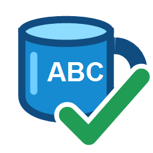

# AGS Spellchecker — offline LanguageTool edition



An editor plugin for **stable AGS 3.6.0, 3.6.1 and 3.6.2** (minimum 3.6.0.47). Reviews player-facing text in the currently opened game using a bundled, fully local LanguageTool engine.

Created with assistance from **OpenAI Codex**.

## Install

Download **AGS-Spellchecker-Setup.exe** from Releases. Close AGS, run Setup, select your AGS installation(s), and restart AGS. Open **AGS Spellchecker** in the project tree, choose **Check language** at the top of the plugin, and press **Scan**.

The installer includes a private Java runtime. No account, subscription, separate Java installation or Internet access for checking is required. Checking runs on localhost only. Windows 10/11 x64 is required for the bundled runtime; the AGS editor can be 32-bit.

For manual installation, extract **AGS-Spellchecker-Portable.zip**, then copy its `AGS.Plugin.Spellchecker.dll` and the entire `Runtime` folder beside `AGSEditor.exe`. Do not copy only the DLL. The DLL-only download from the previous edition is no longer sufficient.

## Review workflow

Rows remain visible throughout review: **red = not checked**, **green = checked**, and **blue = ignored**. Search, filter by category, or sort columns. Original text and current text appear side by side. The issues, suggested fixes and highlighted sentence preview start with equal space and can be resized. Review buttons remain directly beneath them.

**Use suggestion** saves the selected suggestion and advances immediately. For manual edits, choose **Apply & next**. **Ignore** accepts only the selected issue. A line remains unchecked until every issue is corrected or ignored. **Revert selected** restores that line's original text while preserving corrections to other lines. **Go to source** opens the native script/dialogue editor or relevant object property.

A full scan starts only when you press **Scan**. Individual issue results and ignores are remembered for this game and reused while text and dictionary settings are unchanged. Unchanged results are also reused during the current session. Editing a draft checks only that line.

The game dictionary accepts **words and phrases** you explicitly add. It suppresses notices within those entries, including informal-word style notices such as “gonna” and “wanna”; neither word is accepted by default. Select draft text or an issue, then choose **Add to dictionary**, or edit the dictionary under History / settings. Matching respects word boundaries and ignores case; unrelated sentence issues remain checked.

**In game mode, Apply and Revert save the entire AGS project, including other pending edits.** Originals are backed up under `<game>/.ags-proofreader/AGS Spellchecker`. Revert stops if the document has newer changes since the scan. Ignored text, dictionary entries and corrected-line originals persist across sessions.
Checks use LanguageTool's spelling, grammar, capitalization, punctuation and style rules. The language menu provides 59 language/variant choices; coverage varies. This does not include cloud-only AI checks. Informal dialogue and fragments may intentionally trigger rules.

## Language assignment and bulk actions

Choose **Check language**, then **Scan**. Automatic language detection has been removed: unassigned lines always remain visible. Ctrl-click or Shift-click to select multiple rows. Choose a language in **Set language**, then **Assign selected** to label all selected rows. They appear only in that language family; dialect choices still control the checking rules. Choose **Unassigned (all languages)** to remove labels. Assignments are saved and carried through corrections.

**Ignore selected** accepts all issues on the selected lines, including on subsequent scans and in other checking languages. The ordinary **Ignore** button still accepts only the selected issue. **Only unchecked / unresolved** hides completed and ignored rows. History / settings can reset ignores.

Changing **Check language** displays cached results without starting a scan. **Needs scan** means that line needs an explicit scan in the selected language. Saved checking results and individual issue ignores remain separate for each checking language.

## Project translations

Add translations through AGS's Explore Project tree. Spellchecker lists those registered `.trs` sources in **Show text in**. Select **Translations** for all registered translations, or **Translation: filename.trs** for one file. Choose **Check language**, then press **Scan**. Select **All player-facing text** to return to game text. No separate file picker or game-mode button is needed. Scan checks the chosen category; changing the dropdown never starts a scan.

Only nonblank translated entries are checked. Original entries, comments, blank translations, line endings and encoding are preserved. Corrections back up and save the translation source, then refresh AGS's translation data. Save any pending AGS translation edits before scanning or applying corrections. **Revert selected** restores the original translation. **Go to source** opens the file in Notepad; the plugin shows surrounding lines. Recompile translations in AGS to include corrections in the game.

## Adjustable workspace

Drag the divider between the result list and review area, between the left and right columns, or between individual review panels. The correction buttons stay in a fixed row at the bottom right. The panels start with balanced proportions; resizing the plugin preserves the proportions chosen by dragging.

Selecting a suggested fix shows the full corrected line with the replacement highlighted in yellow. Deletions are labeled explicitly. Previewing alone does not modify the draft or game.
## Coverage and limits

Checks known player-facing script calls, dialogue speech/options, GUI text, character/inventory display names, game title, global messages and supported room names/messages. Custom display wrappers, text assembled from variables, arbitrary custom properties are not automatically covered; registered translations are available through Show text in. AGS formatting placeholders are protected.

This is version 1.2.1. See `docs/COMPATIBILITY.md` and the release notes for actual validation. The helper may use up to approximately 2 GB of Java heap; allow additional system memory for AGS and other applications. The installer and engine are unsigned.

## Source and builds

Windows/.NET Framework and the original AGS 3.6.0.47 SDK are required. Build the plugin with:

```powershell
.\Source\build.ps1 -AgsPath 'C:\Tools\AGS-3.6.0.47' -OutputPath '.\dist'
```

Build the complete offline distribution with Inno Setup 6 installed:

```powershell
.\Build-Offline.ps1 -AgsPath 'C:\Tools\AGS-3.6.0.47'
```

The full build downloads pinned dependencies and verifies their SHA-256 hashes. It uses a new artifact staging directory; it does not create or open an AGS game. Runtime archives belong in GitHub Releases, not Git source history.

`Tests/Compatibility.cs` checks the same DLL against each supplied editor SDK. `Tests/EngineTests.cs` checks real local English, French, German and Spanish results, dictionary exceptions and placeholder offsets. Engine tests require the DLL beside its Runtime folder.

## Third-party notices

See `Packaging/THIRD-PARTY-NOTICES.txt` and the unchanged license/notice files inside the runtime distribution. AGS SDK files and game files are not redistributed. This is an independent plugin, not an official AGS, LanguageTool or Microsoft release. No license for the plugin's own source has been selected on the author's behalf.


